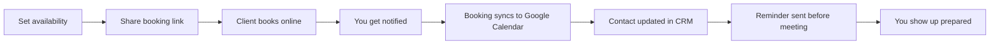

# ISKED — Client Onboarding Overview

Welcome to **ISKED** (isked.app). This guide gives new users a clear picture of what the platform does, how to get started, and where to find the features you'll use every day.

---

## What is ISKED?

ISKED is a web-based scheduling and client-management platform. You share a personal booking link; your clients pick a time that works for them — no back-and-forth emails. Bookings, availability, and client history live in one place.

**In one sentence:** Share your link. They pick a time. You stay in control.

---

## Who is ISKED for?

ISKED is built for professionals and small businesses who regularly meet with clients:

- Consultants, coaches, and advisors  
- Accountants, lawyers, and service providers  
- Sales professionals and network marketers  
- Anyone tired of scheduling ping-pong and scattered client notes  

If you need a reliable booking page *and* a lightweight way to remember who you've met and what you discussed, ISKED is designed for you.

---

## Get started in 3 steps

When you first log in, ISKED shows an **onboarding checklist** on your dashboard. Complete these three steps to go live:

| Step | What to do | Where |
|------|------------|-------|
| **1. Set your availability** | Define when you take meetings — weekly hours, breaks, and date exceptions | Dashboard → Availability |
| **2. Set your display name** | The name clients see on your booking page | Account Settings |
| **3. Share your booking link** | Copy and send your link via email, bio, or invoice | Account Settings |

Your booking link looks like:

```
isked.app/booking/yourusername
```

You can dismiss the checklist once you're comfortable — it won't block anything.

---

## Core features

### 1. Public booking pages

Each user gets a unique, shareable booking page.

- Clients see only **open time slots** based on your rules
- Support for **multiple meeting lengths** (e.g. 15, 30, 60 minutes) — each length can have its own URL
- Optional **meeting link** per duration (Zoom, Google Meet, etc.)
- **Mutual availability** — if both parties use ISKED, a guest can enter their ISKED username to see times that work for both of you
- **Pro:** Upload a **booking page logo** (recommended 400×100px) so your page looks on-brand

Unavailable times are blocked automatically based on:

- Your weekly schedule and breaks  
- Date-specific overrides (holidays, special hours)  
- Existing bookings  
- Google Calendar events (when connected)

---

### 2. Availability & calendar control

You decide when people can book — not the other way around.

| Setting | Purpose |
|---------|---------|
| **Weekly hours** | Different availability per day of the week |
| **Breaks** | Block lunch or gaps inside working hours |
| **Date overrides** | Custom hours or full days off for specific dates |
| **Buffer time** | Breathing room between back-to-back meetings |
| **Minimum notice** | How far in advance someone must book |
| **Maximum window** | How far into the future bookings are allowed |
| **Timezone** | All times display in your timezone; clients see converted times |

---

### 3. Booking management

Your **Dashboard** is your command center.

- Calendar view of all upcoming and past bookings  
- Edit, reschedule, or cancel bookings  
- Filter by date range  
- Each booking stores client name, email, phone, notes, and status  

When a client books, you can get notified by **email**, **SMS** (Philippines), or **Telegram** — depending on your setup.

---

### 4. Built-in CRM

Unlike standalone schedulers, ISKED keeps **client context** where you already work.

**Contacts**

- Store name, email, phone, company, role, and notes  
- Tag and search contacts  
- Track status (lead, prospect, active client, VIP, etc.)  
- Set **next follow-up dates** so nothing slips through  
- BNI-friendly fields for member status and chapter (if you use them)

**Interactions**

- Log meetings, calls, emails, referrals, and follow-ups  
- Link interactions to specific bookings  
- Record outcomes and referral potential

**Referrals**

- Track referrals given and received  
- Monitor status and value

**Automatic CRM updates**

- New bookings can create or update contacts  
- Meeting interactions are logged automatically  

**Pro:** Export your CRM data to **Google Sheets** for reporting and backup.

---

### 5. Integrations

| Integration | What it does |
|-------------|--------------|
| **Google Calendar** | Two-way sync — bookings become calendar events; existing events block your availability |
| **Google Sheets** | Export contacts and interactions (Pro) |
| **Telegram** | Real-time booking alerts via bot |
| **Email (Mailgun)** | Confirmations, reminders, and account emails |
| **SMS (Semaphore)** | Booking confirmations and reminders for Philippine numbers |

Connect integrations from **Account Settings → Integrations**.

---

### 6. Notifications & reminders

ISKED keeps you and your clients informed:

- **Booking confirmations** — sent to you and the client  
- **Reminders** — before the meeting (email and/or SMS)  
- **Change notifications** — when a booking is updated or cancelled  

Make sure your phone number is in Philippine format for SMS: `639xxxxxxxxx` (no leading 0, no spaces).

---

### 7. Short links

Generate **short URLs** for your booking pages — easier to share in bios, SMS, or printed materials. Short links redirect to your full booking page.

---

### 8. Client schedules (recurring meetings)

For accounts with **Client Schedules** enabled, you can book **recurring meetings** with CRM contacts directly from ISKED — useful for retainer clients or regular check-ins. Ask your admin or account contact if this feature should be turned on for you.

---

## Plans & access

| Plan | Price | Highlights |
|------|-------|------------|
| **Free trial** | 5 days | Full access to explore ISKED after signup |
| **Pro (monthly)** | ₱499/month | Unlimited bookings, full CRM, integrations, exports |
| **Pro (yearly)** | ₱4,788/year | Same as Pro — save ~33% vs monthly |
| **Teams** | Custom | Volume pricing, onboarding support — contact sales |

**How to upgrade**

1. Go to **Account Settings → Subscription**  
2. Choose monthly or yearly  
3. Pay via **GCash** (scan QR code)  
4. Upload your **payment proof**  
5. Access activates after admin approval  

Pro includes a **1-day grace period** after expiration before features are restricted.

---

## Typical day with ISKED



1. **Morning** — Check dashboard for today's bookings and follow-up reminders  
2. **During the day** — New bookings arrive with notifications; contacts update automatically  
3. **Before a call** — Review contact notes and interaction history in CRM  
4. **After a call** — Log outcomes, set next follow-up, track any referrals  
5. **Weekly** — Export to Google Sheets or review your calendar for the week ahead  

---

## ISKED vs. other schedulers

| Capability | ISKED | Typical schedulers |
|------------|-------|-------------------|
| Booking link | ✓ | ✓ |
| Client data & history | ✓ | ✗ |
| Built-in CRM | ✓ | ✗ |
| Meeting history per contact | ✓ | ✗ |
| Google Sheets export | ✓ | ✗ |
| Follow-up tracking | ✓ | Limited |

ISKED is scheduling **plus** client memory — without adding another complicated tool to your stack.

---

## Account settings cheat sheet

| Setting | Location | Notes |
|---------|----------|-------|
| Display name & username | Account Settings → Profile | Username is part of your booking URL |
| Booking link | Account Settings | Copy and share from here |
| Meeting durations | Account Settings → Durations | Add lengths and meeting links |
| Availability | Dashboard → Availability | Weekly + date overrides |
| Timezone | Account Settings | Affects all displayed times |
| Booking logo | Account Settings (Pro) | PNG/JPG, max 500KB |
| Google Calendar | Account Settings → Integrations | Authorize and pick calendar |
| Google Sheets | Account Settings → Integrations | Choose export sheet |
| Subscription | Account Settings → Subscription | Upgrade and payment proof |
| Password | Account Settings → Security | Reset via email if forgotten |

---

## Tips for a smooth start

1. **Set realistic availability first** — include buffers so you're not sprinting between calls.  
2. **Add at least one meeting duration** before sharing your link.  
3. **Connect Google Calendar** early so personal events block booking slots.  
4. **Use your display name** — it's what clients see, not your internal full name.  
5. **Check CRM after your first few bookings** — contacts and interactions should appear automatically.  
6. **Save your booking link** in your email signature, social bios, and website.  
7. **Upgrade before trial ends** — you'll get reminder emails as expiration approaches.  

---

## Frequently asked questions

**Do my clients need an ISKED account?**  
No. Anyone with your link can book. If they also use ISKED, they can enter their username to find mutual availability.

**Can clients cancel their own bookings?**  
Currently, only you (the account owner) can modify or cancel bookings from the dashboard.

**What happens when my subscription expires?**  
Your booking pages show an expiration message and Pro features are restricted until you renew.

**Does ISKED work on mobile?**  
Yes. The web app is fully responsive — use it from any phone or tablet browser.

**How do timezones work?**  
Set your timezone in settings. ISKED stores times in UTC and displays them correctly for you and your clients.

**Who do I contact for help?**  
Email **team@smallsimplesteps.co** or book via [isked.app/booking/tjtalusan](https://isked.app/booking/tjtalusan).

---

## Quick reference

| Item | Value |
|------|-------|
| Website | [isked.app](https://isked.app) |
| Sign up | [isked.app/auth/register](https://isked.app/auth/register) |
| Login | [isked.app/auth/login](https://isked.app/auth/login) |
| Your booking link | `isked.app/booking/{username}` |
| Trial period | 5 days |
| Pro pricing | ₱499/mo or ₱4,788/yr |
| Support email | team@smallsimplesteps.co |

---

*Last updated: June 2025*
