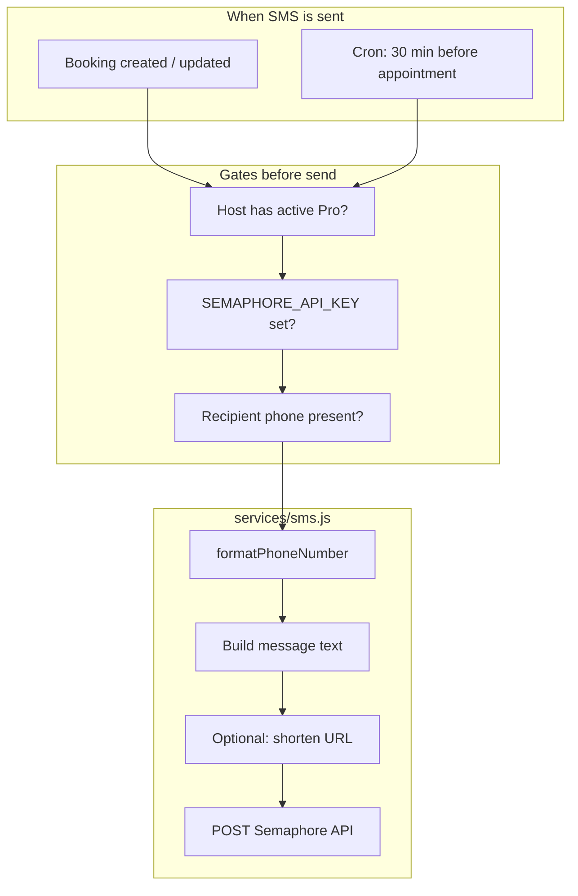

# SMS Implementation Guide

This document describes how SimpleSchedule sends SMS messages so you can reuse the same approach in other Node.js projects. The implementation is intentionally small: one service module, one third-party provider (Semaphore), and fire-and-forget delivery that never blocks core business flows.

---

## Overview

| Item | Value |
|------|--------|
| **Provider** | [Semaphore](https://semaphore.co) (Philippines) |
| **HTTP client** | `axios` |
| **Core module** | `services/sms.js` |
| **API endpoint** | `POST https://api.semaphore.co/api/v4/messages` |
| **Region / numbers** | Philippine mobile numbers (`63` country code) |
| **Sender name** | `isked` (registered in Semaphore dashboard) |

SMS is a **Pro-only** feature in this app. Free users do not trigger sends even if a phone number is present.

---

## Architecture



**Design principles used here:**

1. **Non-blocking** — SMS failures are logged and return `null`; they never throw up to booking creation.
2. **Parallel with email** — Confirmations use `Promise.all([email..., sms...])` so SMS does not delay email.
3. **Normalize phones once** — All numbers are converted to `63XXXXXXXXXX` before the API call.
4. **Optional URL shortener** — Long confirmation links are shortened for the 160-character SMS limit.

---

## Environment variables

Add to `.env`:

```bash
SEMAPHORE_API_KEY=your_api_key_from_semaphore_dashboard
BASE_URL=https://your-app.example.com   # used in message links
```

- Get the API key: Semaphore dashboard → login → API key.
- Register a **sender name** in Semaphore (e.g. `isked`). Messages without a registered sender name fail.
- `BASE_URL` should be your public app URL in production (used in confirmation and reminder links).

---

## Semaphore API contract

**Request** (JSON body via `axios.post`):

| Field | Required | Description |
|-------|----------|-------------|
| `apikey` | Yes | Your API key |
| `number` | Yes | Recipient(s), comma-separated; use international format `639171234567` |
| `message` | Yes | Body (auto-split if &gt; 160 chars). **Do not start with the word `TEST`** — those are silently dropped. |
| `sendername` | No | Registered sender name; defaults to account default if omitted |

**Response:** JSON array of message objects with `message_id`, `recipient`, `status` (`Queued`, `Pending`, `Sent`, `Failed`, `Refunded`), etc.

**Rate limits:** Standard send endpoint is limited to **120 requests/minute**. Bulk the same message to many numbers in one call (comma-separated `number`) when possible.

**Other endpoints** (not used in this repo but available):

- `POST /api/v4/priority` — time-sensitive, 2× credits
- `POST /api/v4/otp` — OTP route with `{otp}` placeholder

Official docs: https://semaphore.co/docs

---

## Phone number formatting

All user-facing numbers may be entered as `09xx`, `9xx`, or `639xx`. The API expects **country code 63, no leading 0, digits only**.

```javascript
function formatPhoneNumber(phone) {
    let cleaned = phone.replace(/\D/g, '');

    if (cleaned.startsWith('0')) {
        cleaned = cleaned.substring(1);
    }

    if (!cleaned.startsWith('63')) {
        cleaned = '63' + cleaned;
    }

    return cleaned;
}
```

**Examples:**

| User input | Sent to API |
|------------|-------------|
| `0917 843 0126` | `639178430126` |
| `9178430126` | `639178430126` |
| `639178430126` | `639178430126` |

For non-Philippines projects, replace this function with your target country’s rules (or use `libphonenumber-js`).

---

## Core send pattern (minimal reusable module)

This is the smallest copy-paste starting point for another project:

```javascript
const axios = require('axios');

const SEMAPHORE_API_KEY = process.env.SEMAPHORE_API_KEY;
const SEMAPHORE_SENDER = 'YourSenderName'; // must be registered in Semaphore
const SEMAPHORE_API_URL = 'https://api.semaphore.co/api/v4/messages';

function formatPhoneNumber(phone) {
    let cleaned = phone.replace(/\D/g, '');
    if (cleaned.startsWith('0')) cleaned = cleaned.substring(1);
    if (!cleaned.startsWith('63')) cleaned = '63' + cleaned;
    return cleaned;
}

async function sendSms(number, message) {
    if (!SEMAPHORE_API_KEY) {
        console.warn('SMS skipped: SEMAPHORE_API_KEY not set');
        return null;
    }

    try {
        const { data } = await axios.post(SEMAPHORE_API_URL, {
            apikey: SEMAPHORE_API_KEY,
            number: formatPhoneNumber(number),
            message: message.trim(),
            sendername: SEMAPHORE_SENDER
        });
        return data;
    } catch (error) {
        console.error('SMS failed:', error.response?.data || error.message);
        return null; // do not throw — keep caller flow intact
    }
}

module.exports = { sendSms, formatPhoneNumber };
```

**Usage:**

```javascript
const { sendSms } = require('./services/sms');

await sendSms('09171234567', 'Hello from my app');
```

---

## Message types in SimpleSchedule

All implementations live in `services/sms.js`.

| Function | Recipient | When | Pro required? |
|----------|-----------|------|----------------|
| `sendBookingConfirmationSMS` | Client (`booking.client_phone`) | After booking is confirmed | Yes |
| `sendHostNotificationSMS` | Host (`host.sms_phone`) | After booking is confirmed | Yes |
| `sendClientReminder30MinSMS` | Client | ~30 min before appointment (cron) | Yes |
| `sendHostReminder30MinSMS` | Host | ~30 min before appointment (cron) | Yes |

### Client booking confirmation

- Builds confirmation URL: `{BASE_URL}/booking/{username}/confirmation/{confirmation_uuid}`
- Shortens URL via `urlShortener.shortenUrl(...)` (30-day expiry); falls back to full URL on error
- Sample message:

```text
Hi Jane, your meeting with John Doe is confirmed!
Date: June 2, 2026
Time: 2:00 PM
Join: https://isked.app/s/abc123
```

### Host new-booking alert

```text
New booking! Jane on June 2, 2026 at 2:00 PM. View: https://isked.app/dashboard
```

### 30-minute reminders

Triggered only from the reminder cron when the matching email reminder was sent in the same run (keeps email/SMS in sync).

---

## Pro subscription gate

SMS functions call `isProActiveForFeatures(host)` from `utils/subscription.js`:

- `host.is_pro` must be true
- If `pro_expires_at` is set, current time must be ≤ expiration + **1 day grace**
- If `pro_expires_at` is null, treat as lifetime Pro

In another project, replace this with your own entitlement check or remove it if SMS is available to everyone.

---

## Where SMS is wired in this codebase

### 1. Booking flow (`routes/booking.js`)

After a booking is saved and optional Google Calendar sync:

```javascript
const notifications = [
    mailService.sendClientConfirmation(booking, host),
    mailService.sendHostNotification(booking, host)
];

if (booking.client_phone && isProActiveForFeatures(host)) {
    notifications.push(smsService.sendBookingConfirmationSMS(booking, host));
}
if (host.sms_phone?.trim() && isProActiveForFeatures(host)) {
    notifications.push(smsService.sendHostNotificationSMS(booking, host));
}

await Promise.all(notifications);
```

Errors are caught at the route level so booking still succeeds.

### 2. Reminder cron (`scripts/runReminders.js`)

- Scheduled on Railway every **15 minutes**
- Selects confirmed bookings in a **15–45 minute** window before start time
- Sends email first; SMS only if the email send succeeded in that run
- Uses `smsService.sendClientReminder30MinSMS` / `sendHostReminder30MinSMS`

Legacy in-process job: `jobs/reminders.js` (same logic; cron script is preferred in production).

### 3. Host SMS number storage

- DB column: `users.sms_phone` (`migrations/042_add_sms_phone.sql`)
- UI: Account settings → “SMS Notifications (Pro)”
- API: `POST /dashboard/account/sms-phone` with `{ "sms_phone": "0917..." }` or empty string to disable

Client phone comes from the booking form field `client_phone`.

### 4. Manual testing (`routes/test.js`)

Only for development/staging:

| Endpoint | Purpose |
|----------|---------|
| `GET /test/sms/:phone` | Sends a fake client confirmation SMS |
| `GET /test/sms/host/:phone` | Sends a fake host notification SMS |

Mock host includes `is_pro: true` and future `pro_expires_at` so Pro checks pass.

---

## URL shortener (optional but recommended)

SMS segments are limited (~160 characters). Confirmation messages include a link, so we shorten it:

- Service: `services/urlShortener.js`
- Stores `code → original_url` in `short_urls` table
- Returns `{BASE_URL}/s/{code}`

When porting to another project, you can:

- Use the same DB-backed shortener, or
- Skip shortening and use a shorter domain/path, or
- Use a third-party shortener API

---

## Error handling checklist

| Scenario | Behavior |
|----------|----------|
| No API key | Log warning in dev; return without sending |
| No client phone | Skip client SMS |
| No host `sms_phone` | Skip host SMS |
| Not Pro | Log and return `null` |
| Semaphore API error | Log `error.response.data`; return `null` |
| Short URL failure | Use full URL in message |
| Booking route | Outer `try/catch` — booking never fails because of SMS |

---

## Porting checklist for a new project

1. Create Semaphore account; buy credits; register **sender name**.
2. Add `SEMAPHORE_API_KEY` (and `BASE_URL`) to environment.
3. Copy `formatPhoneNumber` + `axios.post` pattern into `services/sms.js`.
4. Expose one function per notification type you need.
5. Call SMS **after** the main transaction commits; use `Promise.all` or fire-and-forget.
6. Never `throw` from the SMS layer for provider errors.
7. Add a test route or script to verify delivery to your phone.
8. (Optional) Add subscription or feature flag gate.
9. (Optional) Shorten links if messages exceed one segment.

---

## Dependencies

```json
"axios": "^1.x"
```

No official Semaphore npm package is required; HTTP POST is sufficient.

---

## Related files

| File | Role |
|------|------|
| `services/sms.js` | All send functions |
| `services/urlShortener.js` | Short links for confirmation SMS |
| `utils/subscription.js` | `isProActiveForFeatures()` |
| `routes/booking.js` | Confirmation SMS on create/update |
| `scripts/runReminders.js` | 30-minute reminder SMS |
| `routes/dashboard.js` | `POST /account/sms-phone` |
| `routes/test.js` | Test endpoints |
| `migrations/042_add_sms_phone.sql` | Host phone column |

---

## Troubleshooting

| Symptom | Likely cause |
|---------|----------------|
| No SMS at all | Missing `SEMAPHORE_API_KEY` or host not Pro |
| API 4xx about sender | Sender name not registered or wrong `SEMAPHORE_SENDER` constant |
| Message never arrives | Number not formatted to `63...`; wrong network; insufficient credits |
| Test message ignored | Body starts with `TEST` (Semaphore drops these) |
| 429 / rate limit | More than 120 sends/minute; batch recipients in one request |

Check Semaphore dashboard for delivery status and credit balance (`GET /api/v4/account`).
